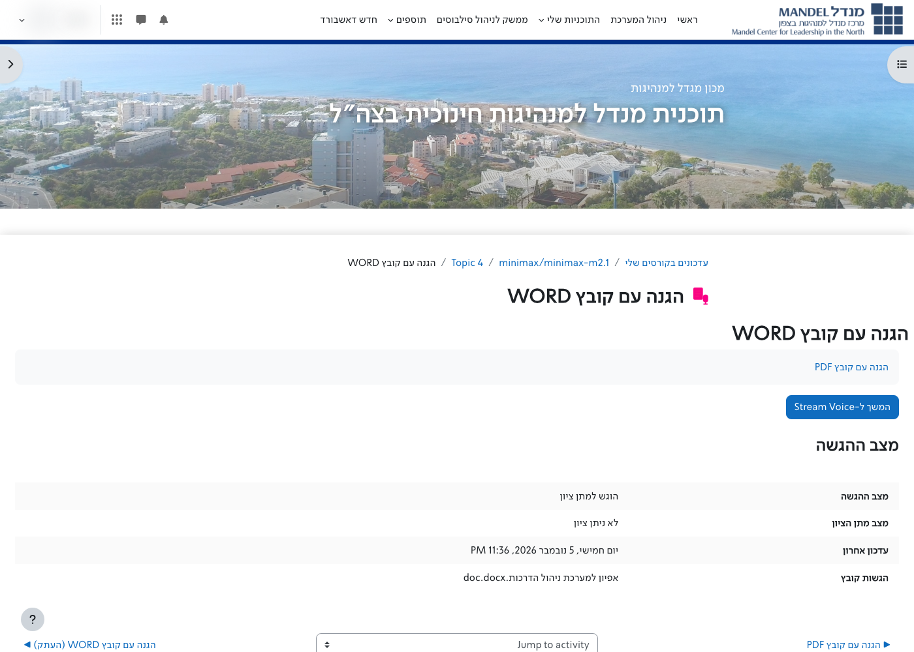
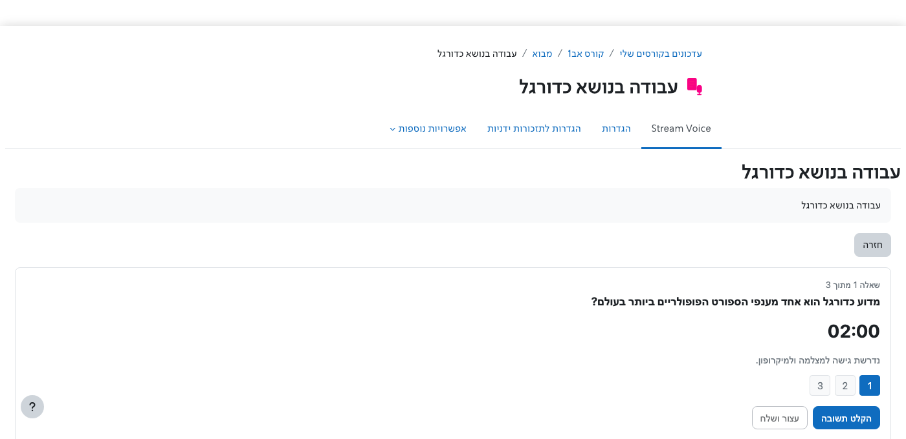
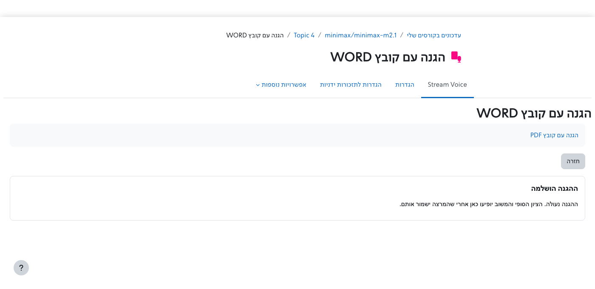
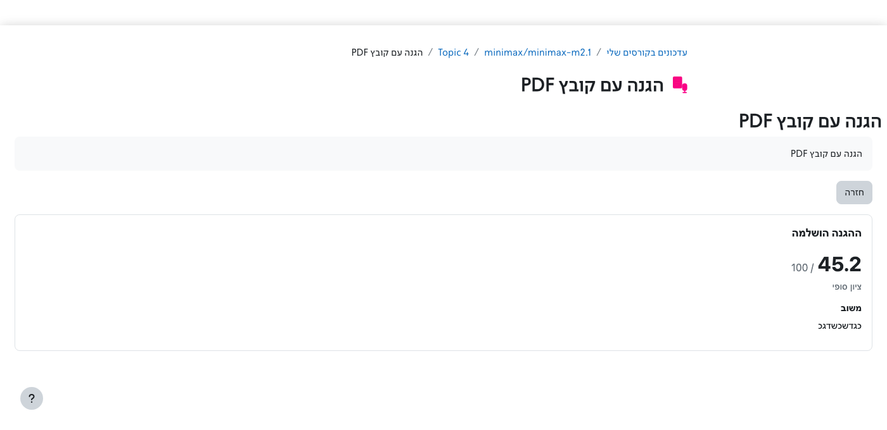
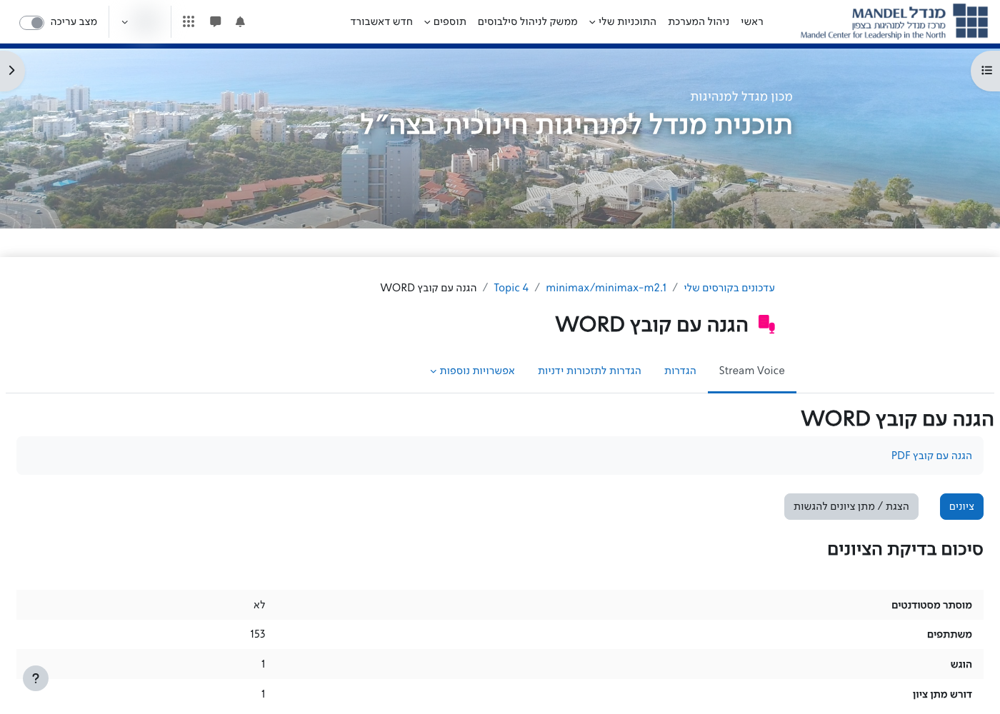
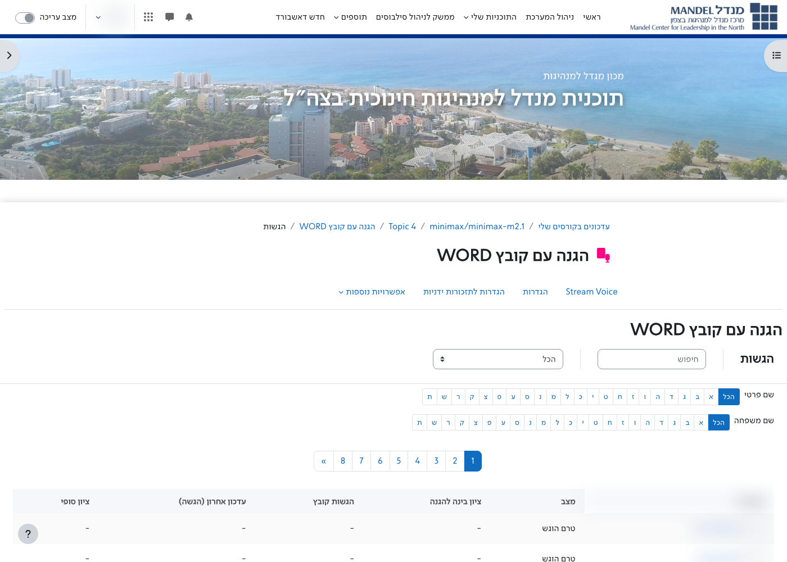
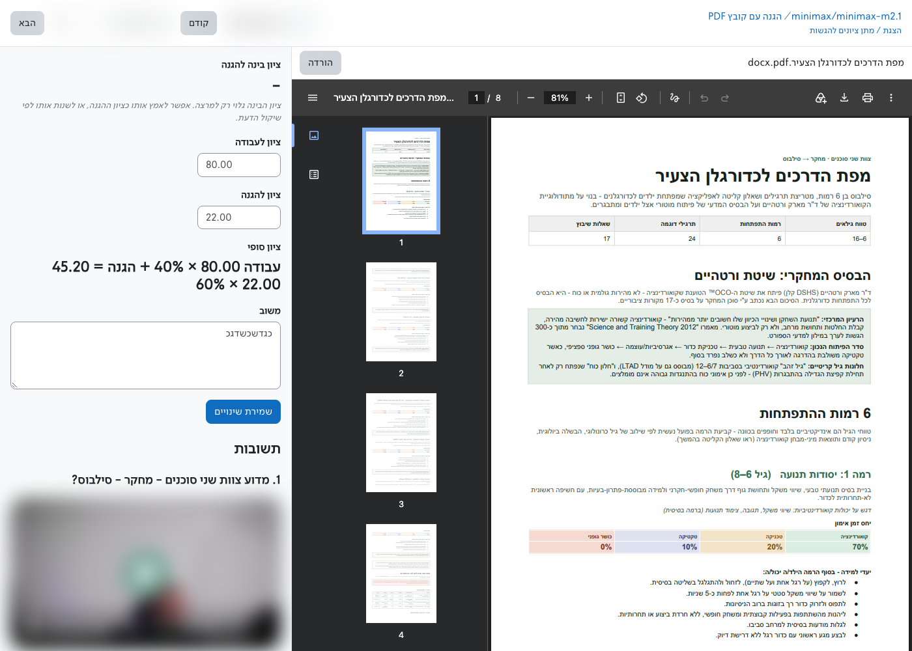

# Stream Voice

Moodle activity module (`mod_streamvoice`) for an oral defense of submitted work.

A student submits a file. Stream Voice locks that file and asks the student to explain it on camera: preparation time with speaker notes, then a timed recording for each question. Stream transcribes the answers, scores them against a rubric, and checks that the explanation matches the locked file. That recommendation stays with the teacher. The teacher grades the written work and the defense, and the saved final grade is what enters the Moodle gradebook and what the student sees.

The aim is to see that the student understands the work and can justify it. The activity does not try to detect whether a tool wrote the file.

Stream Voice is the activity shell inside Moodle. Question generation, the timer, recording, transcription, the rubric and the score run in [Stream](https://stream-platform.cloud/).

## For the institution

A short Hebrew overview for the people who run an institution's systems. It uses the real screens: the student defense, the lock, the teacher's grade, and what is written to the gradebook.

[Stream Voice for institutions (1:37)](docs/stream-voice-institutions.mp4)

## Requirements

* Moodle 4.5 or later.
* The [Stream](https://moodle.org/plugins/local_stream) local plugin (`local_stream` 2023060700 or later), with a Stream site URL and API key.
* A Stream site that provides the Stream Voice API.
* A camera and microphone for students.

`version.php` currently declares `requires` as 2017111300. The activity is developed and used on Moodle 4.5.

## Installation

1. Install and configure **Site administration → Plugins → Local plugins → Stream** (Stream URL and API key).
2. Copy this directory into `mod/streamvoice` on the Moodle server.
3. Log in as an administrator and open **Site administration → Notifications** to install the plugin.
4. Turn editing on in a course and add a **Stream Voice** activity.

## Activity settings

* **Preparation time** and **answer time** are enforced by Stream.
* **Number of questions** is from 1 to 8. Fixed questions, one per line, are asked first. Stream writes any remaining questions from the submitted file.
* **Rubric** is sent to Stream. If it is empty, Stream scores understanding, justification, consistency with the file, and independent reasoning.
* **Weight of the work grade** and **weight of the defense grade** must add up to 100. The final grade is the work grade times the work weight, plus the defense grade times the defense weight. The defense grade starts from Stream's recommendation, and the teacher can change it.
* A new file can be allowed only before the first recording. After that, the file stays locked.

## What people do

Names and pictures of people are blurred in the screenshots below.

### Students

The student opens the activity, submits a file, and continues into the defense. The activity page shows the submission status and the submitted file. It does not show recordings or the automatic score.

Preparation time shows the first question, a countdown, and speaker notes. Saving the notes ends preparation. Each question is then recorded on camera, with its own countdown. The student does not see the recordings afterwards, and there is no button to refresh a score.

When the answers are in, the defense locks. Until the teacher saves a grade, the student only sees that the defense is finished and that the final grade and feedback will appear here.

After the teacher saves, the same screen shows the final grade and the teacher's feedback. Nothing else from the marking is released.

### Teachers

The activity page has the grading summary, **Grade**, and **View all submissions**.

**View all submissions** lists participants, status, the submitted file, Stream's defense score, and the final grade. Grades are not edited on this list. First-letter filters and paging work as they do elsewhere in Moodle.

**Grade** opens a full-screen grader. The submitted file is on one side: PDF and images open in the browser, and a Word file is shown as a reading view. The original file can still be downloaded. On the other side the teacher sees Stream's defense score, types a grade for the work and a grade for the defense, and writes feedback. The defense grade is filled in from Stream's score and can be changed. The final grade is shown as it will be saved, for example work × 40% + defense × 60%. Saving writes that grade to the course gradebook and releases the grade and feedback to the student. Recordings and transcripts stay on this screen, for the teacher only.

### Administrators

Administrators can see Stream Voice usage (activities, locked submissions, questions, recordings and scores) on the Stream usage report. **Site administration → Plugins → Activity modules → Stream Voice** also has a recording check: it records a few seconds in the browser and plays them back, and it does not upload anything.

## Privacy

Moodle keeps the activity settings and the gradebook grade.

The submitted file, recordings, transcripts, questions and the automatic score are stored on the configured Stream server. See the privacy metadata string in this plugin, and the privacy information of the Stream site you connect.

## Backup and restore

The activity supports Moodle backup and restore, including duplication inside a course. Duplication copies the activity settings. It does not copy student submissions or recordings.

## License

GNU GPL v3 or later. See <https://www.gnu.org/licenses/gpl-3.0.html>.

## Support

CentricApp LTD — <dev@centricapp.co>

* Product page: <https://stream-platform.cloud/#stream-voice>
* Stream for Moodle: <https://moodle.org/plugins/local_stream>
